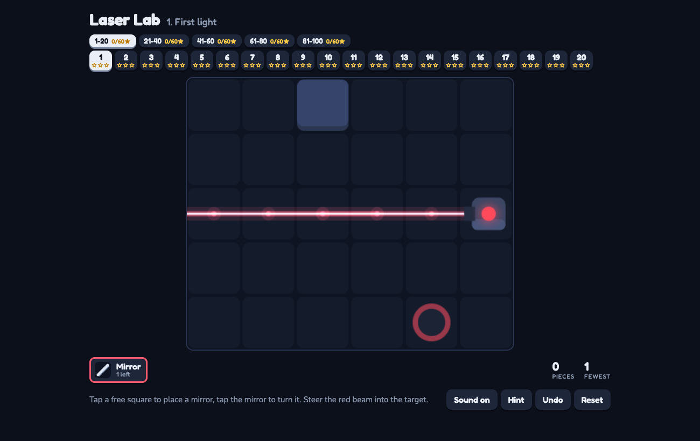

# Laser Lab

### ▶ [Play Laser Lab in your browser](https://louisvandenbruwaene.github.io/laser-lab/)

No install, no account: open the link and play. Tap a free square to place a mirror, tap it again to turn it, and steer each beam into its target.

[](https://louisvandenbruwaene.github.io/laser-lab/)

Laser Lab: bend coloured lasers with mirrors and splitters onto matching targets. One self-contained HTML file, no build step: open [`index.html`](index.html).

## Play on this Mac

```
./app/install_app.sh   # puts Laser Lab in /Applications
./app/make_icon.sh     # only needed after editing app/icon.html
```

The app opens the game in its own Brave window. The folder path is baked in, so re-run `install_app.sh` if this folder moves.
